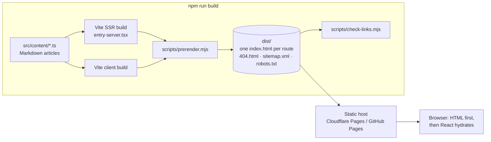

# Site architecture

## Goals

- Fast, crawlable pages without running a server.
- Content editable without touching layout code.
- No secrets in the client; no backend dependency.
- Accessible (WCAG 2.2 AA-oriented) and responsive from 320 px up.

## Overview



### Static generation (prerendering)

- `src/entry-server.tsx` exports the list of routes (static pages + one per case study, lab entry and article) and a `render(url)` function using `react-dom/server` and React Router's `StaticRouter`.
- `scripts/prerender.mjs` renders every route into `dist/<route>/index.html`, injecting the page-specific `<head>` (title, description, canonical, Open Graph, Twitter and JSON-LD).
- In the browser, `src/entry-client.tsx` hydrates the existing HTML; subsequent navigation is client-side.

### Head and SEO

Each page renders a `<Seo>` component (`src/components/Seo.tsx`). During prerendering it hands its metadata to a collector; in the browser it updates `document.head` on navigation. `src/utils/head.ts` builds the tags and the `Person`, `WebSite`, `Article` and `BlogPosting` structured data.

### Content

All content is typed TypeScript or Markdown under `src/content/`. Components only read from it. Blog Markdown is compiled **at build time** by `plugins/articles.ts` (marked + highlight.js), so the browser receives ready HTML and neither library is shipped to visitors.

### Diagrams

Diagrams are Mermaid source strings (in TS content) or ` ```mermaid ` blocks (in Markdown). Mermaid is large, so `src/utils/mermaid.ts` imports it **lazily** in the browser only when a page contains a diagram. The prerendered HTML contains a placeholder plus a full text description of each diagram for screen readers and crawlers. `DiagramViewer` adds a source view and an expandable full-screen dialog; narrow screens scroll the diagram horizontally inside its frame rather than the page.

### Styling

Tailwind CSS 4 with **two switchable colour themes** (`src/styles/index.css`):

- **Executive Technology** (default) — deep navy hero and page headers, white content sections, blue calls to action (`#2563EB`), Inter headings, and faint dashed architecture connectors behind the hero icons.
- **Premium Consulting** — white backgrounds, charcoal headings (`#1C1F24`), muted steel-blue accents (`#3F5B80`), Source Serif 4 headings.

Every Tailwind colour utility reads a CSS variable, so a theme is just a set of variable values: Executive values live in the `@theme` block and Consulting overrides them under `html[data-theme='consulting']`. The navy header re-scopes the neutral tokens locally (`.surface-header`) so the same markup reads light-on-navy. Visitors switch with the palette button in the header, or the labelled control in the mobile menu (`src/components/theme.tsx`). The choice is stored in `localStorage` (`jb-theme`) and applied by a small inline script in `index.html` before first paint, so there is no flash of the wrong theme; Mermaid diagrams re-render in the matching palette. The first-visit default is `site.defaultTheme`. A faint AI/cloud line-icon pattern (`src/components/TechBackdrop.tsx`) decorates the hero and page headers in both themes. Both fonts are self-hosted via Fontsource — no third-party font requests. Includes reduced-motion handling, visible focus rings and print styles for the resume page.

### Contact form

No backend. If `site.contactForm.endpoint` is set (e.g. Formspree), the form POSTs JSON to it and reports success or failure. Otherwise it validates input and opens the visitor's email app with a pre-filled message — and says so plainly.

### Quality gates

- `tsc --noEmit` (strict, `noUncheckedIndexedAccess`).
- Build fails if an article has invalid front matter or an unknown category.
- Prerender fails if any route renders without `<Seo>` metadata.
- `scripts/check-links.mjs` fails the build on any broken internal link, asset or `#anchor`.

### Hosting base path

Set `BASE_PATH=/repo-name/` at build time to host under a sub-path (GitHub Pages project sites). Router basename, asset URLs, Markdown links, canonical URLs, sitemap and link checks all honour it.
