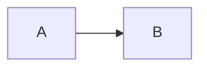

# Content maintenance

All content lives in `src/content/`. You never need to edit components or pages to change text, links, projects, articles or certifications. After editing, run `npm run dev` to preview, then `npm run build` to verify.

## Owner inputs and placeholders

These items need your input or confirmation before (or soon after) going live.

| # | What | Where | Status |
|---|---|---|---|
| 1 | **Production URL** (e.g. `https://jainbai.dev`) | `src/content/site.ts` → `url` | **Required.** Currently `https://example.com`; canonical URLs, sitemap and social cards use it. |
| 2 | **Publishable resume PDF** (without phone number) | Put the file in `public/documents/`, then set `site.resume.pdfPath`, e.g. `'/documents/Jain-Bai-B-Resume.pdf'` | Recommended. The current resume PDF includes a personal phone number, so it was deliberately **not** published. Until set, the Resume page offers "Print / save as PDF". |
| 3 | **Case-study review** | `src/content/case-studies/*.ts` → `reviewStatus: 'approved'` | **Required.** The four experience-based case studies are generalized drafts. Check wording, confidentiality and whether you have permission to name clients. |
| 4 | **Client names on case studies** | `site.discloseClientNames` | Optional. `false` (default) shows anonymized descriptions such as "A global automotive manufacturer". Set `true` only with permission. |
| 5 | **GitHub profile** | `site.github` | Optional. Empty = all GitHub links hidden. |
| 6 | **Certification details** | `src/content/certifications.ts` → `issued`, `expires`, `verifyUrl`, `badge` | Optional. Add official verification links (Credly / Google Cloud) and badge images in `public/images/badges/`. Empty fields are hidden. |
| 7 | **Contact form endpoint** | `site.contactForm.endpoint` | Optional. E.g. a Formspree form URL. Without it, the form opens the visitor's email app. |
| 8 | **Email shown publicly** | `site.email` | Confirm you are happy to publish `jainbaiberkumance@gmail.com`, or use a dedicated address. |
| 9 | **Location line** | `site.location` | Confirm wording ("Based in India · Working with global, distributed teams"). |
| 10 | **Blog articles** | `src/content/articles/*.md` | Five draft/demo articles are included and labelled as such. Edit, replace or set `draft: false` when you publish your own. |
| 11 | **Default colour theme** | `site.defaultTheme` | Optional. `'executive'` (navy + blue, default) or `'consulting'` (white + charcoal). Visitors can switch either way. |
| 12 | **Profile photo** | Replace `assets-src/profile-source.jpg`, then run `npm run assets` | Done (from supplied photo). A higher-resolution original (≥ 800 px wide) would look sharper on large screens. |

### Points in the resume worth double-checking

These were spotted while building the site; the site currently follows the resume.

- The resume summary says "**Currently** Solution Architect at Quest Global", while the role is dated **Aug 2024 – May 2026**. The site shows the dates and does not say "currently".
- Key achievements mention platforms "supporting **10M+** users"; the HUE project lists **5M+** users. The site uses 5M+ for that platform and omits the 10M+ figure.
- Equifax environment lists **Java 21**, the technologies line lists **Java 17**. The site uses Java 17.
- "Client recognition from PepsiCo leadership" is listed under awards without a role; it is shown as-is on the Certifications and Resume pages.
- The 70% deployment-time reduction is not attributed to a specific program; it appears only as a general achievement.

## Profile, bio and experience

`src/content/profile.ts` holds the headline, intro, short bio, career stats, About-page text, architecture principles, leadership points, interests, skills, experience, earlier roles, education and awards. Stats on the home page come from `profile.stats` — only use figures you can verify.

To change the photo, replace `assets-src/profile-source.jpg` and run `npm run assets` (also regenerates the favicons and the social image). Update `profile.photo.width/height` if the aspect ratio changes.

## Site settings and links

`src/content/site.ts`: name, role, tagline, location, email, LinkedIn, GitHub, resume PDF, contact form endpoint, client-name disclosure and default social image. The navigation menu is the `nav` array in the same file.

## Expertise

`src/content/expertise.ts`. Each area has a `depth`:

- `production` — delivered on programs.
- `applied` — used within programs.
- `exploring` — learning interest.

Put technologies you are learning in `exploring: [...]` rather than `technologies`, so the page stays honest. `related` links must point at existing routes (the build's link check will catch mistakes).

## Case studies

One file per study in `src/content/case-studies/`, typed by `types.ts`. To add one:

1. Copy an existing file, change `slug` (becomes `/case-studies/<slug>/`) and fill in every field.
2. Use `kind: 'conceptual'` for designs that were not deployed; the page then shows a "Conceptual design" notice.
3. Put only resume-verifiable facts in `verifiedFacts`.
4. Add it to the array in `src/content/case-studies/index.ts` (order = display order).

Never include confidential architecture, internal system names, source code, customer data or proprietary details.

## Architecture Lab

`src/content/lab/index.ts`. Each entry has a `type` (`Reference architecture`, `Pattern`, `ADR`, `Checklist`), optional Mermaid `diagram` and `sections` with `body` paragraphs, `list` bullets or `checklist` items.

## Blog articles

Create `src/content/articles/<slug>.md`:

````markdown
---
title: My article title
summary: One or two sentences used on cards and in search results.
date: 2026-11-01
category: Cloud Architecture
tags: AWS, Security
draft: false
---

Intro paragraph…

## A section heading

Text, lists, tables, `inline code`, and fenced code blocks with a language:

```java
System.out.println("hello");
```


````

- `category` must be one of: Solution Architecture, Cloud Architecture, Java and Microservices, System Design, Kubernetes and DevOps, Enterprise Integration, AI and GenAI Architecture, Architecture Leadership.
- `##` and `###` headings form the table of contents automatically.
- Highlighted languages: java, typescript, json, yaml, sql, bash, markdown. Add more in `src/utils/markdown.ts`.
- Internal links use root paths, e.g. `[case study](/case-studies/claims-microservices/)`.
- Optional `updated: YYYY-MM-DD` sets the modified date.

Reading time, related articles, sharing links, canonical URL and `BlogPosting` structured data are generated automatically.

## Certifications

`src/content/certifications.ts`. `featured: true` shows a certification on the home page. Leave `verifyUrl`, `issued`, `expires` and `badge` empty rather than guessing — empty fields are hidden.

## Diagrams

Mermaid syntax: <https://mermaid.js.org/intro/>. Keep node labels short (use `<br/>` for line breaks) so diagrams stay readable on phones. Always provide a `description` (text alternative) and a `caption` for diagrams in TS content.
