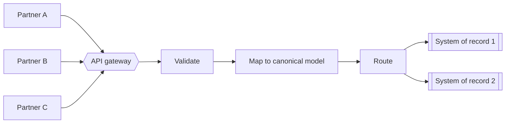

Integrating with one partner is a project. Integrating with hundreds is an architecture problem. The approach that works for the first partner — a bespoke mapping, a shared credential, a direct call into an internal system — becomes a liability by the tenth.

## Standardize the contract, absorb variation at the edge

The central idea: expose **one standardized, versioned API contract** to every partner, and handle partner-specific differences in a thin edge layer. Internal systems then see a single canonical shape, regardless of who sent the data.

## Design the contract for change

Partners release on their own schedules, so contract evolution must be deliberate:

- **Additive changes only** within a major version; never repurpose a field.
- **Explicit versioning** in the path or a header, with a published deprecation window.
- **Machine-readable specifications** (OpenAPI) so partners can generate clients and validate payloads before calling you.
- **A sandbox environment** with realistic test data — it shortens onboarding more than any document.

## Security per partner, not per platform

Each partner gets its **own credentials and scopes**. That makes revocation, quota enforcement and auditing possible at the partner level. Validate schemas and payload sizes at the gateway, so malformed input never reaches systems of record.

## Choose sync vs. async per interaction

| Interaction | Style | Why |
|---|---|---|
| Submit a document | Async (accept, then process) | Partners should not wait on internal back ends |
| Look up a status | Sync API | Small, fast, read-only |
| Bulk historical load | Batch or file | Volume is better handled out of band |

## Make onboarding repeatable

The real measure of a partner-integration architecture is how much effort the *next* partner takes. Aim for a checklist-driven onboarding: credentials issued, sandbox tested, contract tests passed, go-live — with no new architecture required.

> **Draft / demo article.** General guidance for illustration; it does not describe any specific organization's systems.
