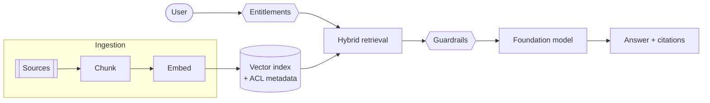

A retrieval-augmented generation (RAG) prototype can be built in an afternoon: embed some documents, retrieve the closest chunks, and ask a model to answer. Turning that into something an enterprise can rely on is a different exercise. This article sketches a conceptual reference architecture and the decisions that matter most.

## The shape of the system



On AWS, one way to assemble this is Amazon Bedrock for foundation models and guardrails, Amazon OpenSearch for hybrid keyword and vector search, and Lambda or Step Functions for ingestion. The same shape works with other providers.

## Decision 1: permissions belong in retrieval

The most important rule: **a user must never receive an answer built from a document they cannot open.** Store access-control metadata with every chunk and filter at query time, using the caller's resolved entitlements. Do not rely on the model to withhold information it has already been given.

## Decision 2: hybrid retrieval

Enterprise content is full of product codes, ticket numbers and acronyms. Pure vector similarity can miss exact identifiers, while keyword search misses paraphrases. Combining both and re-ranking the results is a sensible default to evaluate.

## Decision 3: grounding and refusal

Instruct the model to answer only from the supplied context, to cite its sources, and to say when it does not know. A confident wrong answer costs more trust than an honest "I couldn't find that".

## Decision 4: evaluation as a pipeline

Before tuning prompts or comparing models, assemble a set of real questions with known good answers and sources. Track at least:

- **Retrieval quality** — did the right passages come back?
- **Groundedness** — is every claim supported by the retrieved context?
- **Citation accuracy** — do citations point to the right sources?
- **Latency and cost per query.**

Run the set on every change to prompts, chunking, models or retrieval settings.

## A small example: shaping the prompt

```java
String prompt = """
    You are an internal knowledge assistant.
    Answer ONLY from the context below. Cite sources as [n].
    If the context is insufficient, say you could not find the answer.

    Context:
    %s

    Question: %s
    """.formatted(renderContext(passages), question);
```

## Where to go next

See the [conceptual case study](/case-studies/enterprise-knowledge-assistant/) and the [reference architecture](/architecture-lab/rag-knowledge-assistant/) in the Architecture Lab.

> **Draft / demo article.** A conceptual design for discussion; it does not report results from a deployed system.
