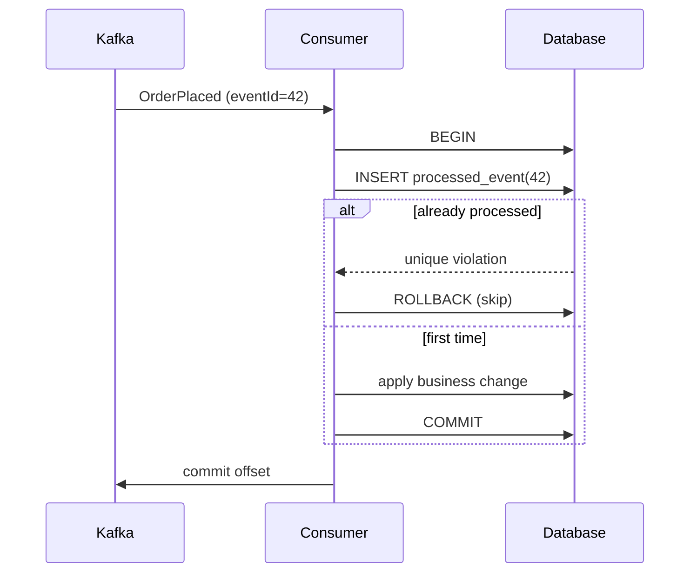

Kafka consumers in most real systems run with **at-least-once** delivery: if a consumer crashes after processing a record but before committing its offset, the record is delivered again. Retries in producers can also introduce duplicates. The practical answer is not to prevent duplicates entirely, but to make processing **idempotent** — handling the same event twice has the same effect as handling it once.

## The pattern

1. Every event carries a stable, unique **event ID** set by the producer.
2. The consumer records processed IDs in the **same database transaction** as its business change.
3. Before processing, the consumer checks whether the ID has already been recorded.



## Schema

```sql
CREATE TABLE processed_event (
  event_id     VARCHAR(64) PRIMARY KEY,
  processed_at TIMESTAMP NOT NULL DEFAULT CURRENT_TIMESTAMP
);
```

## Consumer implementation

```java
@Component
@RequiredArgsConstructor
public class OrderPlacedConsumer {

    private final ProcessedEventRepository processedEvents;
    private final BillingService billing;

    @KafkaListener(topics = "order-events", groupId = "billing")
    @Transactional
    public void onMessage(OrderPlaced event) {
        if (!processedEvents.tryRecord(event.eventId())) {
            return; // duplicate: already handled
        }
        billing.createInvoice(event.orderId(), event.amount());
    }
}
```

```java
public interface ProcessedEventRepository {
    /** Returns false if the event ID was already recorded. */
    boolean tryRecord(String eventId);
}
```

A JDBC implementation can use `INSERT ... ON CONFLICT DO NOTHING` (PostgreSQL) and check the affected row count, which avoids relying on exception handling for control flow.

## Configuration notes

```yaml
spring:
  kafka:
    consumer:
      enable-auto-commit: false
      isolation-level: read_committed
    listener:
      ack-mode: record
```

- Disable auto-commit so offsets are committed only after successful processing.
- Configure a dead-letter topic with Spring Kafka's `DefaultErrorHandler` and `DeadLetterPublishingRecoverer` for poison messages.
- Clean up old `processed_event` rows on a schedule longer than the topic's retention period.

## When this is not enough

If the side effect is outside your database — calling a payment provider, for example — pass the event ID as an **idempotency key** to that provider as well. The principle is the same: make every boundary safe to retry.

> **Draft / demo article.** Illustrative code for discussion; adapt and test it for your own stack before use.
