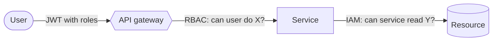

In a microservices platform, a single over-privileged credential can turn a small bug into a major incident. Least privilege — every principal gets only the access it needs, and nothing more — is easy to agree with and surprisingly hard to sustain. These are the practices I find most effective.

## 1. One identity per service

Never share credentials between services. Each service gets its own identity:

- **AWS:** an IAM role per workload, assumed via IAM Roles for Service Accounts (IRSA) on EKS or task roles on ECS.
- **Google Cloud:** a dedicated service account per workload, bound through Workload Identity on GKE.

With one identity per service, audit logs show exactly which service did what, and revoking access is surgical.

## 2. Scope permissions to actions and resources

Grant specific actions on specific resources rather than wildcards:

```json
{
  "Version": "2012-10-17",
  "Statement": [
    {
      "Sid": "ReadOrderEvents",
      "Effect": "Allow",
      "Action": ["sqs:ReceiveMessage", "sqs:DeleteMessage", "sqs:GetQueueAttributes"],
      "Resource": "arn:aws:sqs:eu-west-1:123456789012:order-events"
    },
    {
      "Sid": "WriteInvoices",
      "Effect": "Allow",
      "Action": ["dynamodb:PutItem", "dynamodb:GetItem"],
      "Resource": "arn:aws:dynamodb:eu-west-1:123456789012:table/invoices"
    }
  ]
}
```

*(Example account ID and resources are placeholders.)*

## 3. Separate infrastructure IAM from application authorization

Cloud IAM controls **which service can reach which resource**. Application-level RBAC controls **which user can perform which business action**. Both are needed:



Enforce RBAC consistently at the API layer, and re-check critical authorization inside services so a misrouted call cannot bypass it.

## 4. Make least privilege the easy path

- Define roles in **infrastructure as code** and review them like application code.
- Provide **reusable policy modules** for common patterns (read a queue, write a table).
- Use the cloud provider's **access analysis tools** to find unused permissions and tighten roles over time.
- Prefer **short-lived credentials**; avoid long-lived access keys entirely for workloads.

## 5. Review regularly

Permissions drift. Make IAM review part of the [architecture review checklist](/architecture-lab/architecture-review-checklist/) and of every significant change.

> **Draft / demo article.** General guidance for illustration; validate policies against your own environment and the provider's documentation.
